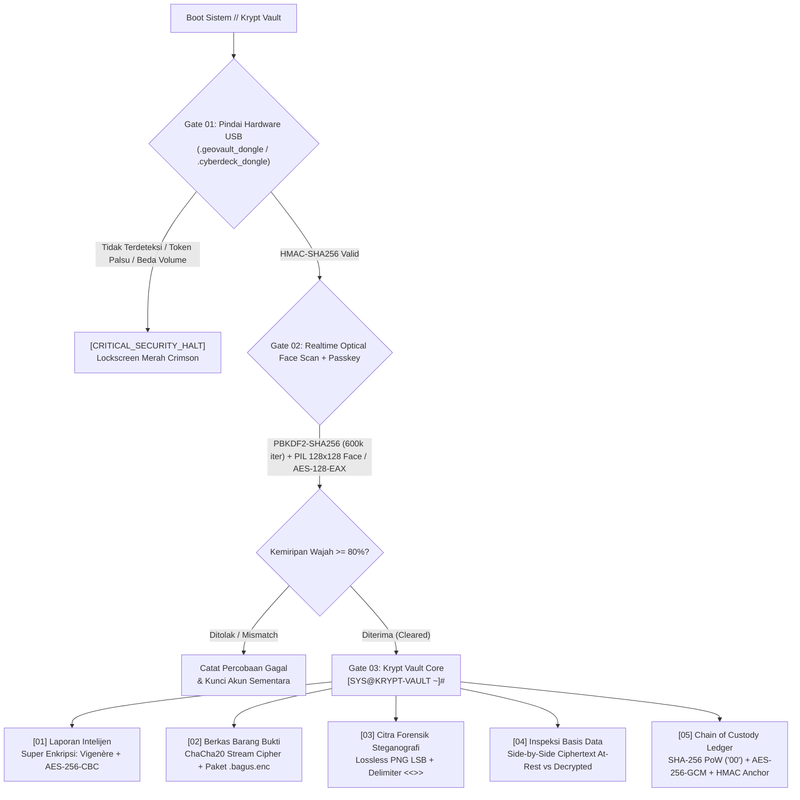

# ⚡ Krypt Vault — Sistem Pengamanan Bukti Forensik Siber & Dokumen Intelijen Strategis

```text
 ██████╗    █████╗   ██████╗  ██╗   ██╗ ███████╗    ██╗   ██╗  █████╗  ██╗   ██╗ ██╗  ████████╗
 ██╔══██╗  ██╔══██╗ ██╔════╝  ██║   ██║ ██╔════╝    ██║   ██║ ██╔══██╗ ██║   ██║ ██║  ╚══██╔══╝
 ██████╔╝  ███████║ ██║  ███╗ ██║   ██║ ███████╗    ██║   ██║ ███████║ ██║   ██║ ██║     ██║   
 ██╔══██╗  ██╔══██║ ██║   ██║ ██║   ██║ ╚════██║    ╚██╗ ██╔╝ ██╔══██║ ██║   ██║ ██║     ██║   
 ██████╔╝▄ ██║  ██║▄╚██████╔╝▄╚██████╔╝▄███████║▄    ╚████╔╝  ██║  ██║ ╚██████╔╝ ███████╗██║   
 ╚═════╝ ▀ ╚═╝  ╚═╝▀ ╚═════╝ ▀ ╚═════╝ ▀╚══════╝▀     ╚═══╝   ╚═╝  ╚═╝  ╚═════╝  ╚══════╝╚═╝   
```

**Krypt Vault (*Biometric-Authenticated Gatekeeper & Unified Security Vault*)** adalah sistem pengamanan data pertahanan berlapis (*defense-in-depth digital evidence vault*) berbasis Python dan Streamlit. Dirancang khusus untuk mengamankan bukti forensik digital, berkas perkara kejahatan siber, dan dokumen intelijen geospasial strategis melalui antarmuka Cyberdeck Command Line Interface (`[SYS@KRYPT-VAULT ~]#`) bertema Netrunner dengan telemetri eksekusi *real-time*.

---

## 🏛️ Filosofi Arsitektur Keamanan

Krypt Vault mengimplementasikan prinsip ketahanan kriptografi tingkat militer:

1. **Zero-Plaintext Persistence (Enkripsi At-Rest)**: Tidak ada password mentah, vektor biometrik wajah, laporan teks, maupun dokumen yang tersimpan dalam format terbuka di database SQLite (`storage/geovault.db`) maupun sistem berkas lokal.
2. **Hierarki Kunci Terpisah (HKDF-SHA256 Key Hierarchy)**: Master secret 256-bit CSPRNG mendistribusikan sub-kunci domain independen (`dongle/hmac-sha256`, `auth/password-pepper`, `ledger/aes-256-gcm`, `ledger/anchor-hmac`).
3. **Sequential Security Gatekeeper**:
   - **Gate 01**: Intersep Hardware Dongle USB (`HMAC-SHA256` token). Akses ke seluruh sistem terkunci mati jika dongle tidak terpasang.
   - **Gate 02**: Pemindaian Wajah Otis Real-Time (*Realtime Auto-Scanning Optical Face Recognition*) menggunakan normalisasi matriks `128x128` Grayscale PIL, `SHA-256` pixel digest, dan enkripsi terautentikasi **AES-128-EAX** dipadukan dengan passkey **PBKDF2-HMAC-SHA256 (600.000 iterasi)**.
   - **Gate 03**: Evidence Vault Core yang memuat 5 subsistem pengamanan dokumen intelijen dan bukti forensik.

---

## 🔐 Diagram Alur Kriptografi



---

## 🛡️ Spesifikasi 7 Modul Kriptografi

### 1. Hardware Dongle Authentication (`HMAC-SHA256` USB Token)
- Menginspeksi partisi penyimpanan fisik melalui `psutil` untuk menemukan token otorisasi `.geovault_dongle` atau `.cyberdeck_dongle`.
- Memvalidasi tanda tangan kriptografis kanonikal **HMAC-SHA256** dalam waktu konstan (*constant-time verification*).
- Mengikat token dengan nomor seri volume drive Windows (`GetVolumeInformationW`) untuk menangkal penggandaan bit (*anti-cloning protection*).
- Menyediakan Lockscreen Crimson Red beranimasi hazard pulsing dengan tabel diagnostik USB bus serta saklar demo *Mount / Unmount Virtual Dongle*.

### 2. Realtime Optical Facial Recognition + Salted `SHA-256` & `AES-128-EAX` Login
- **Faktor Pengetahuan (Passkey)**: Passphrase digarami salt 16-byte CSPRNG dan diregangkan dengan **PBKDF2-HMAC-SHA256** (600.000 iterasi) + server pepper melalui **HKDF-SHA256** menghasilkan `auth/verifier` (32B) dan `auth/biometric-key` (16B).
- **Faktor Melekat (Pemindai Wajah Otomatis Real-Time)**: Pemindaian sensor optik wajah secara otomatis selama 2 detik dengan HUD reticle Cyberpunk tanpa memerlukan tombol manual *Take Photo*.
- **Normalisasi PIL**: Diproses murni via Pillow (`PIL`) tanpa dependensi OpenCV cascade loader: konversi ke Grayscale 8-bit (`.convert("L")`), normalisasi matriks `128x128` piksel, komputasi `SHA-256` byte digest, serta ekstraksi deskriptor struktural `phash` dan `dhash`.
- **Enkripsi Template**: Vektor biometrik wajah disegel dalam SQLite menggunakan **AES-128-EAX** dengan Associated Authenticated Data (AAD) yang terikat pada username operator.

### 3. Laporan Intelijen (Super Enkripsi: `Vigenère Cipher` + `AES-256-CBC`)
- **Tahap 1 (Substitusi Polialfabetik Klasik)**: Transformasi Extended Vigenère terhadap byte stream UTF-8 modulo 256:
  $$C_i = (P_i + K_{i \bmod |K|}) \bmod 256$$
- **Tahap 2 (Block Cipher Modern)**: Padding PKCS#7 dan enkripsi **AES-256-CBC** dengan IV acak 16-byte CSPRNG serta kunci 256-bit turunan PBKDF2-HMAC-SHA256.
- Dilengkapi antarmuka dua arah: Enkripsi dengan pratinjau live telemetry tiap tahap, dan Dekripsi untuk memulihkan plaintext asli dari token Base64 database.

### 4. Berkas Barang Bukti (`ChaCha20` Stream Cipher)
- Mengenkripsi berkas biner barang bukti dokumen (PDF, DOCX, TXT, CSV, JPG, PNG, ZIP, KML) menggunakan cipher aliran simetris **ChaCha20** dengan kunci 256-bit (PBKDF2 200.000 iterasi) dan nonce acak 12-byte.
- Membungkus ciphertext ke dalam amplop mandiri `.bagus.enc` ber-magic header yang memuat checksum integritas `SHA-256`.
- Antarmuka dekripsi mampu memulihkan nama dan ekstensi asli berkas serta memvalidasi kesesuaian SHA-256.

### 5. Citra Forensik Steganografi (Lossless PNG `LSB` + Delimiter `<<<END>>>`)
- Menyisipkan pesan rahasia intelijen ke dalam Least Significant Bit komponen warna RGB citra PNG lossless secara kasat mata:
  $$C'_{c} = (C_{c} \mathbin{\&} \text{0xFE}) \mathbin{|} b_k, \quad c \in \{R, G, B\}$$
- Menggunakan pembatas terminal `<<<END>>>` sehingga ekstraksi berhenti tepat di akhir payload tanpa noise carrier.
- Mendukung proteksi passphrase tambahan sebelum penyisipan bit.

### 6. Inspeksi Basis Data (Encrypted SQLite At-Rest vs Decrypted View)
- Audit forensik independen side-by-side: Menampilkan data mentah ciphertext SQLite yang tersimpan di disk `storage/vault.db` (hash PBKDF2, BLOB template wajah AES-128-EAX, token super-enkripsi Base64, dan metadata ChaCha20) dibandingkan dengan tampilan data terdekripsi terautentikasi.

### 7. Chain of Custody Ledger (Proof-of-Work Blockchain & Integritas Aset)
- Mencatat riwayat rantai bukti digital ke dalam buku besar tak terubahkan (*immutable ledger*) dan sinkronisasi otomatis ke `storage/ledger.json`.
- Setiap blok bukti disegel dengan enkripsi terautentikasi **AES-256-GCM** dan ditambang menggunakan algoritma konsensus **Proof-of-Work SHA-256** dengan tingkat kesulitan prefix `"00"`.
- Dilindungi tanda tangan **HMAC Chain-Tip Anchor** pada `app_meta` yang mendeteksi segala bentuk manipulasi SQLite langsung (*Tamper Lab*).

---

## 🧪 Pengujian Otomatis (Automated Unit Test Suite)

Sistem dilengkapi suite pengujian otomatis mandiri yang menguji dan membuktikan kehandalan seluruh 7 modul kriptografi:
```bash
python tests/test_crypto_modules.py
```
Hasil uji: **7 tests run, 100% OK (Passed)**.

---

## 📂 Struktur Repositori Proyek

```text
geovault-crypto-app/
├── app.py                      # Main Cyberpunk HUD UI Router & Gatekeeper
├── config.py                   # Hierarki Kunci & Konfigurasi Path vault.db
├── database.py                 # SQLite At-Rest Persistence Layer (vault.db)
├── generate_dongle.py          # Script Provisioning USB Token & CLI
├── ui_cyberpunk.py             # Cyberpunk Theme, HUD CSS & Telemetry Logs
├── modules/
│   ├── __init__.py             # Inisialisasi Paket Modul Kriptografi
│   ├── dongle_guard.py         # [Kriteria 1] Hardware USB Dongle & HMAC
│   ├── auth_biometric.py       # [Kriteria 2] Face Scanner PIL & AES-128-EAX
│   ├── super_encryption.py     # [Kriteria 3] Super Enkripsi Vigenère + AES-256
│   ├── file_crypto.py          # [Kriteria 4] ChaCha20 File Stream Cipher
│   ├── steganography.py        # [Kriteria 6] LSB PNG Image Steganography
│   └── blockchain.py           # [Kriteria 7] PoW SHA-256 Blockchain Ledger
├── storage/
│   ├── vault.db                # [Kriteria 5] Encrypted SQLite Database
│   ├── ledger.json             # Cadangan State Blockchain JSON
│   └── files/                  # BLOB Berkas Biner Terenkripsi
├── tests/
│   └── test_crypto_modules.py  # Unit Test Suite Otomatis 7 Kriteria
├── docs/
│   ├── LAPORAN_AKHIR_KRIPTOGRAFI.md   # Naskah Laporan Akademik Lengkap
│   ├── LAPORAN_AKHIR_KRIPTOGRAFI.docx # Dokumen Word Laporan Akhir Siap Cetak
│   ├── PANDUAN_DEMO_PENGUJIAN.md      # Panduan Ujian & Demonstrasi Dosen (Pak Bagus)
│   └── generate_report_docx.py        # Script Generator Berkas Word DOCX
├── requirements.txt            # Dependensi Python
└── README.md                   # Dokumentasi Utama Proyek
```

---

## 🚀 Panduan Menjalankan Aplikasi

### 1. Prasyarat & Instalasi
Pastikan Python 3.10+ telah terpasang. Jalankan instalasi dependensi:
```bash
pip install -r requirements.txt
```

### 2. Menjalankan Aplikasi
Buka terminal dan jalankan:
```bash
streamlit run app.py
```

### 3. Panduan Demonstrasi Pengujian (Demo Mode)
1. **Menguji Status Kunci Dongle (Locked State)**:
   - Saat aplikasi pertama kali dibuka tanpa USB dongle, layar otomatis beralih ke **Crimson Red Lockscreen** (`// CRITICAL_SECURITY_HALT`).
   - Buka panel ekspander `[ DEV_DEMO: MOUNT / UNMOUNT VIRTUAL DONGLE ]`.
   - Klik `[ MOUNT_VIRTUAL_DONGLE ]` untuk mensimulasikan pemasangan flashdisk otorisasi secara instan.
2. **Menguji Pemindaian Wajah Real-Time**:
   - Daftarkan akun baru di tab `[02] ENROLL_NEW_IDENTITY`. Masukkan operator handle dan passkey, lalu klik `[ ⚡ INITIALIZE_REALTIME_OPTICAL_SCAN ]`.
   - Masuk di tab `[01] AUTHENTICATE_OPERATOR`. Centang opsi `[ Simulasikan Wajah Tidak Cocok / Penyusup ]` untuk mendemonstrasikan penolakan biometrik secara langsung di depan penguji.
3. **Menguji Enkripsi & Dekripsi**:
   - Uji Super Enkripsi pada menu `[01] LAPORAN INTELIJEN` dan pulihkan kembali teks aslinya di tab Dekripsi.
   - Uji Enkripsi Berkas Dokumen pada menu `[02] BERKAS BARANG BUKTI`, unduh berkas `.bagus.enc`, dan dekripsi kembali untuk mendapatkan berkas asli.
   - Uji Penyisipan & Ekstraksi Steganografi pada menu `[03] CITRA FORENSIK STEGANOGRAFI`.
   - Tunjukkan bukti enkripsi at-rest pada menu `[04] INSPEKSI BASIS DATA`.
   - Tambang blok bukti dan simulasikan serangan manipulasi basis data pada menu `[05] CHAIN OF CUSTODY LEDGER`.
