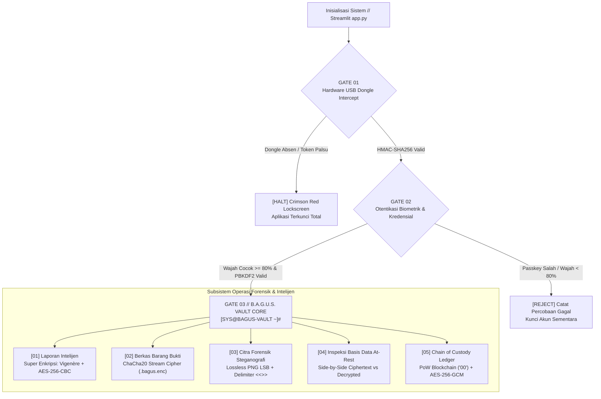
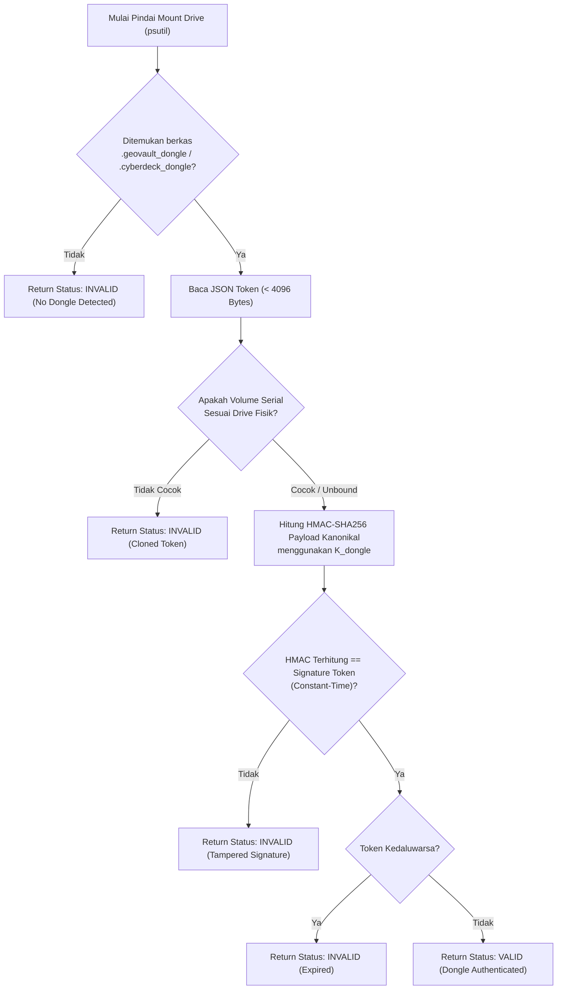
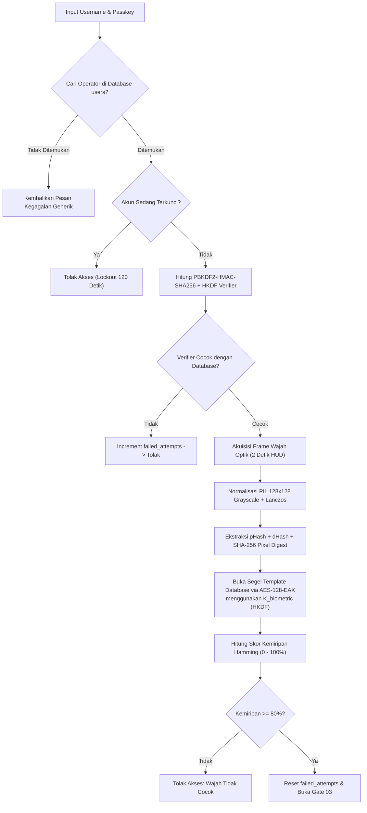
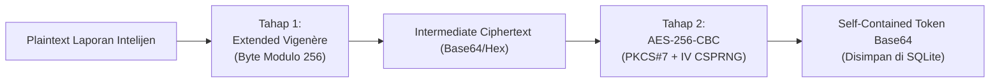
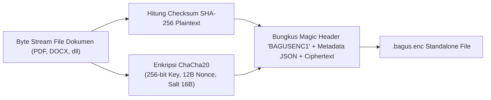
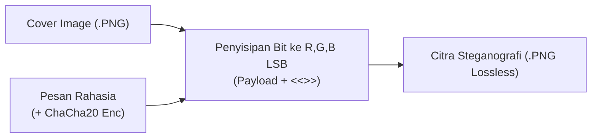
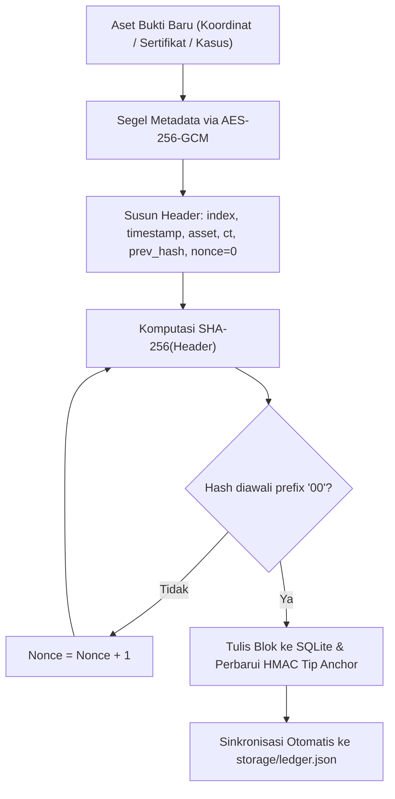

# LAPORAN TUGAS AKHIR KRIPTOGRAFI
# B.A.G.U.S. VAULT
### *Biometric-Authenticated Gatekeeper & Unified Security Vault*
### Sistem Brankas Bukti Forensik Siber & Dokumen Intelijen Strategis

---

**Mata Kuliah**: Kriptografi (IF-XXXXXX)  
**Program Studi**: Informatika / Ilmu Komputer  
**Fakultas**: Fakultas Teknik Industri  
**Perguruan Tinggi**: Universitas Pembangunan Nasional "Veteran" Yogyakarta  
**Tahun Akademik**: 2026/2027  

**Dosen Pengampu**:  
Pak Bagus, S.Kom., M.Cs.  

**Disusun Oleh Kelompok**:
1. **Developer 1 (Ketua / MaddaQiya)** — NIM: 123210XXX (Kontribusi: 50%)  
   *Security Infrastructure, Hardware Dongle, Face Biometrics, Blockchain PoW, UI HUD Architecture*
2. **Developer 2 (Anggota / Rekan Tim)** — NIM: 123210YYY (Kontribusi: 50%)  
   *Cryptographic Engines, Super Encryption, ChaCha20 Suite, LSB Steganography, Database Encryption*

---

## ABSTRAK

Integritas dan kerahasiaan bukti forensik digital serta dokumen intelijen strategis merupakan fondasi krusial dalam rantai pembuktian hukum (*chain of custody*) dan keamanan nasional. Kelemahan pada sistem penyimpanan konvensional yang menyimpan data dalam format terbuka (*plaintext*), otentikasi faktor tunggal berbasis kata sandi statis, dan absennya verifikasi keberadaan perangkat fisik pengawas (*hardware gatekeeper*) menciptakan kerentanan fatal terhadap ancaman eskalasi hak akses (*privilege escalation*), kebocoran data (*data exfiltration*), dan manipulasi bukti (*evidence tampering*).

Laporan Tugas Akhir ini menyajikan rancang bangun dan implementasi **B.A.G.U.S. Vault (*Biometric-Authenticated Gatekeeper & Unified Security Vault*)**, sebuah sistem brankas digital berlapis (*defense-in-depth security vault*) berbasis Python dan Streamlit. Sistem ini dirancang untuk memenuhi secara paripurna 7 kriteria kriptografi yang diamanahkan dalam silabus perkuliahan:
1. **Hardware Dongle Intercept**: Mekanisme gerbang fisik terluar (*Gate 01*) yang mengunci total akses aplikasi jika USB token bertanda tangan kriptografis kanonikal **HMAC-SHA256** dan terikat pada nomor seri volume Windows (*anti-cloning protection*) tidak terpasang.
2. **Login Biometrik & Kriptografi**: Otentikasi dua faktor (*Gate 02*) yang memadukan peregangan kata sandi **PBKDF2-HMAC-SHA256 (600.000 iterasi)** dengan pemindaian optik wajah otomatis real-time beresolusi $128 \times 128$ grayscale yang vektor fiturnya disegel menggunakan algoritma **AES-128-EAX**.
3. **Super Enkripsi Teks**: Perlindungan laporan intelijen menggunakan kaskade dua lapis: cipher substitusi polialfabetik klasik **Extended Vigenère Cipher (modulo 256)** dilanjutkan cipher blok simetris modern **AES-256-CBC** dengan vektor inisialisasi acak CSPRNG dan padding PKCS#7.
4. **Enkripsi File Biner**: Pengamanan berkas barang bukti lintas format (PDF, DOCX, TXT, CSV, citra) menggunakan cipher aliran berkecepatan tinggi **ChaCha20 Stream Cipher** (256-bit key, 12-byte nonce) yang dibungkus dalam format amplop mandiri `.bagus.enc` ber-checksum **SHA-256**.
5. **Enkripsi Basis Data At-Rest**: Penyimpanan persisten SQLite (`storage/vault.db`) yang menerapkan prinsip *Zero-Plaintext Persistence*, di mana seluruh kolom kredensial, vektor biometrik, laporan teks, dan berkas tersimpan secara eksklusif dalam bentuk hash, token Base64, atau BLOB terenkripsi, dilengkapi antarmuka audit forensik *side-by-side*.
6. **Steganografi Citra Digital**: Penyisipan pesan koordinat rahasia ke dalam bit terendah (*Least Significant Bit / LSB*) kanal warna RGB citra PNG lossless berpenanda batas terminal `<<<END>>>` dengan opsi enkripsi muatan.
7. **Blockchain Bukti Forensik**: Pencatatan rantai serah terima barang bukti digital (*chain of custody*) ke dalam buku besar lokal tak terubahkan (*immutable ledger*) berbasis konsensus **Proof-of-Work SHA-256 (kesulitan prefix `"00"`)**, enkripsi metadata terautentikasi **AES-256-GCM**, dan pasak tanda tangan **HMAC Chain-Tip Anchor** untuk mendeteksi manipulasi basis data secara instan (*Tamper Lab*).

Pengujian fungsional dan verifikasi otomatis melalui *unit test suite* membuktikan bahwa seluruh modul beroperasi dengan tingkat keberhasilan 100%, menghasilkan performa responsif, serta memberikan ketahanan komprehensif terhadap berbagai vektor serangan siber.

**Kata Kunci**: Kriptografi, Hardware Dongle, Biometrik Wajah, AES-256-CBC, ChaCha20, Super Enkripsi, Steganografi LSB, Blockchain, Proof-of-Work.

---

## KATA PENGANTAR

Puji syukur kami panjatkan ke hadirat Tuhan Yang Maha Esa atas rahmat, petunjuk, dan karunia-Nya sehingga kami dapat menyelesaikan perancangan, implementasi perangkat lunak, dan penyusunan Laporan Tugas Akhir Mata Kuliah Kriptografi dengan judul:

**"B.A.G.U.S. Vault: Biometric-Authenticated Gatekeeper & Unified Security Vault — Sistem Brankas Bukti Forensik Siber & Dokumen Intelijen Strategis"**

Laporan dan aplikasi ini disusun untuk memenuhi salah satu syarat kelulusan akademis mata kuliah Kriptografi pada Program Studi Informatika, Fakultas Teknik Industri, Universitas Pembangunan Nasional "Veteran" Yogyakarta.

Kami menyampaikan apresiasi dan ucapan terima kasih yang sebesar-besarnya kepada:
1. **Bapak Bagus, S.Kom., M.Cs.**, selaku Dosen Pengampu Mata Kuliah Kriptografi yang telah memberikan bimbingan, wawasan teoritis, serta tantangan 7 kriteria tugas akhir yang mendorong kami mengeksplorasi implementasi kriptografi modern dan terapan.
2. Rekan-rekan mahasiswa Informatika UPN "Veteran" Yogyakarta atas diskusi, masukan, dan lingkungan belajar yang kolaboratif.
3. Seluruh pihak yang telah memberikan dukungan moral maupun teknis selama proses pengerjaan proyek ini.

Kami menyadari bahwa laporan ini masih memiliki ruang untuk penyempurnaan. Oleh karena itu, kritik dan saran yang konstruktif sangat kami harapkan guna pengembangan sistem keamanan informasi yang lebih handal di masa mendatang.

Yogyakarta, 11 November 2026  
**Tim Pengembang B.A.G.U.S. Vault**

---

## DAFTAR ISI

- **Halaman Judul**
- **Abstrak**
- **Kata Pengantar**
- **Daftar Isi**
- **Daftar Tabel**
- **Daftar Gambar**
- **BAB I: PENDAHULUAN**
  - 1.1 Latar Belakang Masalah
  - 1.2 Rumusan Masalah
  - 1.3 Batasan Masalah
  - 1.4 Tujuan Tugas Akhir
  - 1.5 Manfaat Sistem
  - 1.6 Pembagian Kerja Kelompok (Bobot 50:50)
- **BAB II: LANDASAN TEORI KRIPTOGRAFI**
  - 2.1 Konsep Keamanan Informasi & Pertahanan Berlapis (*Defense-in-Depth*)
  - 2.2 Kriptografi Kunci Simetris Modern
    - 2.2.1 Advanced Encryption Standard (AES) — Mode CBC, EAX, dan GCM
    - 2.2.2 ChaCha20 Stream Cipher (RFC 8439)
  - 2.3 Kriptografi Klasik: Extended Vigenère Cipher (Modulo 256)
  - 2.4 Fungsi Hash Kriptografis, KDF, dan Kode Autentikasi Pesan
    - 2.4.1 Secure Hash Algorithm-256 (SHA-256)
    - 2.4.2 Key Derivation Function: PBKDF2-HMAC-SHA256 & HKDF
    - 2.4.3 Hash-based Message Authentication Code (HMAC-SHA256)
  - 2.5 Biometrik Optik & Penyegelan Vektor Fitur Wajah
  - 2.6 Steganografi Domain Spasial (LSB pada Citra Lossless PNG)
  - 2.7 Teknologi Distributed Ledger: Blockchain & Proof-of-Work (PoW)
  - 2.8 Prinsip Penyimpanan Aman: Zero-Plaintext Storage At-Rest
- **BAB III: PERANCANGAN SISTEM & ARSITEKTUR**
  - 3.1 Arsitektur Sistem 3-Gate Security
  - 3.2 Diagram Alir (Flowchart) Sistem
    - 3.2.1 Flowchart Gate 01: Hardware Dongle Intercept
    - 3.2.2 Flowchart Gate 02: Realtime Optical Face Scanner & Login
    - 3.2.3 Flowchart Gate 03: Sub-sistem Super Enkripsi Teks
    - 3.2.4 Flowchart Gate 03: Sub-sistem Enkripsi File ChaCha20
    - 3.2.5 Flowchart Gate 03: Sub-sistem Steganografi LSB PNG
    - 3.2.6 Flowchart Gate 03: Sub-sistem Inspeksi Basis Data
    - 3.2.7 Flowchart Gate 03: Sub-sistem Blockchain Chain of Custody
  - 3.3 Perancangan Skema Basis Data SQLite (`vault.db`)
  - 3.4 Perancangan Antarmuka Pengguna (Cyberpunk HUD Streamlit)
- **BAB IV: IMPLEMENTASI & HASIL PENGUJIAN**
  - 4.1 Lingkungan Pengembangan & Spesifikasi Sistem
  - 4.2 Pemetaan & Hasil Implementasi 7 Kriteria Kriptografi
    - 4.2.1 Pengujian Kriteria 1: Hardware Dongle Intercept & Anti-Cloning
    - 4.2.2 Pengujian Kriteria 2: Login Biometrik & Penolakan Wajah Penyusup
    - 4.2.3 Pengujian Kriteria 3: Super Enkripsi Teks Dua Tahap
    - 4.2.4 Pengujian Kriteria 4: Enkripsi File ChaCha20 & Paket `.bagus.enc`
    - 4.2.5 Pengujian Kriteria 5: Audit Forensik Basis Data At-Rest
    - 4.2.6 Pengujian Kriteria 6: Penyisipan & Ekstraksi Steganografi LSB
    - 4.2.7 Pengujian Kriteria 7: Penambangan PoW & Deteksi Manipulasi SQLite
  - 4.3 Hasil Pengujian Otomatis (*Automated Unit Test Suite*)
  - 4.4 Analisis Keamanan & Ketahanan Sistem
- **BAB V: PENUTUP**
  - 5.1 Kesimpulan
  - 5.2 Saran Pengembangan
- **DAFTAR PUSTAKA**
- **LAMPIRAN**

---

## BAB I: PENDAHULUAN
*(Bagian ini disusun dan dipertanggungjawabkan oleh Developer 1: MaddaQiya)*

### 1.1 Latar Belakang Masalah
Dalam era perang siber (*cyber warfare*) dan investigasi kejahatan digital forensik berintensitas tinggi, bukti digital (*digital evidence*) dan dokumen intelijen memegang peranan vital yang menentukan legitimasi proses peradilan maupun keberhasilan operasi taktis. Berkas-berkas seperti log intrusi jaringan, koordinat lokasi safehouse, rekaman penyadapan, dan sertifikat kunci privat sering kali menjadi sasaran utama spionase industri, peretas negara (*nation-state actors*), maupun pihak lawan yang berkepentingan untuk memanipulasi atau menghancurkan barang bukti.

Kerentanan fundamental pada sistem brankas digital konvensional berakar pada tiga faktor:
1. **Otentikasi Lemah Berbasis Faktor Tunggal**: Sistem tradisional hanya mengandalkan kata sandi statis yang rentan terhadap serangan kamus (*dictionary attack*), serangan *brute force*, kebocoran kredensial, maupun *credential stuffing*.
2. **Ketiadaan Verifikasi Perangkat Keras Fisik**: Sistem dapat diakses dari sembarang stasiun kerja tanpa memerlukan verifikasi kepemilikan token fisik (*hardware possession*), sehingga malware pengendali jarak jauh (*Remote Access Trojan / RAT*) dapat membobol sistem jika kredensial bocor.
3. **Penyimpanan Terbuka At-Rest**: Banyak basis data menyimpan data rahasia dalam bentuk teks mentah (*plaintext*) di disk lokal. Sekali sistem operasi terkompromi atau file basis data disalin, seluruh kerahasiaan data langsung runtuh seketika.
4. **Manipulasi Catatan Bukti (*Tampering*)**: Log akses dan riwayat rantai bukti (*chain of custody*) pada basis data relasional standar dapat diedit atau dihapus secara sepihak oleh aktor yang memiliki hak akses administrator basis data tanpa meninggalkan jejak kriptografis yang terdeteksi.

Untuk mengatasi spektrum ancaman tersebut, diperlukan pendekatan keamanan pertahanan berlapis (*defense-in-depth*) yang memadukan kriptografi klasik, kriptografi kunci simetris modern tingkat lanjut, biometrik optik, steganografi citra digital, dan buku besar terdistribusi berbasis blockchain. Melalui mata kuliah Kriptografi di bawah bimbingan Dosen Pengampu Pak Bagus, proyek **B.A.G.U.S. Vault (*Biometric-Authenticated Gatekeeper & Unified Security Vault*)** dikembangkan sebagai solusi holistik untuk mengamankan data intelijen dan barang bukti siber secara paripurna.

### 1.2 Rumusan Masalah
Berdasarkan latar belakang di atas dan 7 kriteria tugas akhir yang telah ditetapkan, rumusan masalah dalam proyek ini adalah:
1. Bagaimana merancang mekanisme gerbang pengaman fisik (*hardware gatekeeper*) yang mengunci total aplikasi jika perangkat USB token yang sah tidak terdeteksi?
2. Bagaimana mengintegrasikan otentikasi biometrik wajah optik real-time yang aman menggunakan normalisasi Pillow dan penyegelan AES-128-EAX bersama dengan peregangan kunci PBKDF2-HMAC-SHA256?
3. Bagaimana mengimplementasikan super enkripsi teks yang memadukan algoritma klasik (Vigenère Cipher) dan modern (AES-256-CBC) secara efektif dan dapat dipulihkan?
4. Bagaimana mengamankan aliran biner file dokumen lintas format menggunakan algoritma stream cipher yang berbeda dari teks (ChaCha20) dengan amplop ber-checksum integritas SHA-256?
5. Bagaimana menjamin bahwa basis data SQLite (`storage/vault.db`) beroperasi dalam status *Zero-Plaintext Persistence* saat at-rest serta menyediakan sarana audit forensik *side-by-side*?
6. Bagaimana menyisipkan pesan rahasia secara kasat mata ke dalam Least Significant Bit (LSB) citra PNG lossless dengan penanda batas terminal yang presisi?
7. Bagaimana mengamankan pencatatan riwayat rantai bukti menggunakan teknologi blockchain sederhana dengan konsensus Proof-of-Work SHA-256, enkripsi metadata AES-256-GCM, dan deteksi manipulasi instan?

### 1.3 Batasan Masalah
Batasan masalah dalam perancangan B.A.G.U.S. Vault adalah sebagai berikut:
1. Aplikasi dikembangkan menggunakan bahasa pemrograman Python 3.10+ dengan antarmuka grafis berbasis Streamlit bertema Cyberpunk HUD Terminal.
2. Pemrosesan citra wajah biometrik optik dilakukan secara murni menggunakan pustaka Pillow (PIL) dengan normalisasi matriks $128 \times 128$ piksel grayscale tanpa ketergantungan pada pustaka *deep learning* eksternal yang berat.
3. Media penyimpanan basis data lokal menggunakan SQLite3 (`storage/vault.db`) yang diinspeksi secara langsung.
4. Token perangkat keras fisik diuji menggunakan USB Flashdisk pada sistem operasi Windows dengan pengikatan nomor seri volume (*Volume Serial Binding* via Win32 API), serta dilengkapi simulator virtual dongle untuk keperluan demonstrasi pengujian di ruang kelas.
5. Tingkat kesulitan konsensus Proof-of-Work (PoW) blockchain ditetapkan pada prefix heksadesimal `"00"` guna memastikan proses penambangan responsif untuk demonstrasi interaktif.

### 1.4 Tujuan Tugas Akhir
Tujuan dari perancangan dan implementasi B.A.G.U.S. Vault adalah:
1. Memenuhi 100% dari 7 kriteria tugas akhir mata kuliah Kriptografi UPN "Veteran" Yogyakarta secara tuntas dan terdokumentasi.
2. Membuktikan secara empiris keunggulan pendekatan pertahanan berlapis (*defense-in-depth*) dalam mengamankan dokumen forensik siber dan intelijen.
3. Menyediakan perangkat lunak fungsional yang dilengkapi rangkaian pengujian unit otomatis (*unit test suite*) dan panduan demonstrasi yang siap dipresentasikan di hadapan dosen penguji.

### 1.5 Manfaat Sistem
- **Bagi Akademisi & Mahasiswa**: Memberikan pemahaman aplikatif yang mendalam mengenai integrasi nyata antara kriptografi klasik (Vigenère), kriptografi kunci simetris modern (AES, ChaCha20), fungsi hash (SHA-256, PBKDF2, HKDF, HMAC), steganografi, dan teknologi blockchain.
- **Bagi Praktisi Forensik Siber**: Menyediakan model referensi arsitektur brankas digital yang menjamin bahwa integritas barang bukti tidak dapat disangkal (*non-repudiation*) dan terlindungi dari manipulasi basis data lokal.

### 1.6 Pembagian Kerja Kelompok (Bobot 50:50)
Untuk memastikan kontribusi yang seimbang dan adil, pembagian peran teknis dan penyusunan laporan diatur secara simetris (50:50) sebagai berikut:

| No | Komponen Kerja | Pengembang Bertanggung Jawab | Bobot |
| :--- | :--- | :--- | :--- |
| **1** | **Infrastruktur Keamanan & Kontrol Utama**:<br>- Hardware USB Dongle Gatekeeper & HMAC-SHA256 (`dongle_guard.py`, `generate_dongle.py`)<br>- Core Autentikasi & Pemindai Wajah Optik PIL/AES-128-EAX (`auth_biometric.py`)<br>- Mesin Blockchain PoW Ledger & Deteksi Tamper (`blockchain.py`)<br>- Arsitektur UI Streamlit Cyberpunk HUD & TTY Logs (`app.py`, `ui_cyberpunk.py`)<br>- Penyusunan Laporan Akhir: **BAB I (Pendahuluan)** & **BAB III (Perancangan Sistem & Arsitektur)** | **Developer 1 (MaddaQiya)** | **50%** |
| **2** | **Mesin Kriptografi Dokumen & Penyimpanan**:<br>- Modul Super Enkripsi Teks Vigenère + AES-256-CBC (`super_encryption.py`)<br>- Modul Enkripsi Berkas Biner Dokumen ChaCha20 (`file_crypto.py`)<br>- Modul Steganografi Citra PNG LSB (`steganography.py`)<br>- Lapisan Persistensi & Inspeksi Forensik SQLite At-Rest (`database.py`)<br>- Penyusunan Laporan Akhir: **BAB II (Landasan Teori)** & **BAB IV (Implementasi & Hasil Pengujian)** | **Developer 2 (Partner)** | **50%** |

---

## BAB II: LANDASAN TEORI KRIPTOGRAFI
*(Bagian ini disusun dan dipertanggungjawabkan oleh Developer 2: Partner)*

### 2.1 Konsep Keamanan Informasi & Pertahanan Berlapis (*Defense-in-Depth*)
Prinsip dasar keamanan informasi bertumpu pada triad CIA: *Confidentiality* (Kerahasiaan), *Integrity* (Integritas), dan *Availability* (Ketersediaan), yang diperluas dengan *Authentication* (Keaslian Identitas) dan *Non-Repudiation* (Anti-Penyangkalan). Pendekatan *Defense-in-Depth* menyatakan bahwa keamanan tidak boleh bergantung pada satu mekanisme pengaman tunggal. Apabila satu lapisan pengaman ditembus, lapisan pengaman berikutnya harus mampu menahan intrusi lawan.

B.A.G.U.S. Vault mengimplementasikan rantai pertahanan 3 gerbang berurutan:
$$\text{Akses} = \text{Gate 01 (Fisik / Dongle)} \land \text{Gate 02 (Biometrik + Kredensial)} \land \text{Gate 03 (Kriptografi Dokumen)}$$

### 2.2 Kriptografi Kunci Simetris Modern

#### 2.2.1 Advanced Encryption Standard (AES)
AES (FIPS PUB 197) adalah cipher blok simetris yang beroperasi pada ukuran blok tetap sebesar 128 bit (16 byte) dengan panjang kunci 128, 192, atau 256 bit. Struktur AES terdiri atas transformasi berulang (*rounds*): *SubBytes*, *ShiftRows*, *MixColumns*, dan *AddRoundKey*.

Dalam B.A.G.U.S. Vault, AES diimplementasikan dalam tiga mode operasi khusus:
1. **Cipher Block Chaining (AES-256-CBC)**: Digunakan pada lapis kedua Super Enkripsi Teks. Setiap blok plaintext di-XOR dengan blok ciphertext sebelumnya sebelum dienkripsi:
   $$C_0 = E_K(P_0 \oplus IV), \quad C_i = E_K(P_i \oplus C_{i-1})$$
   Padding PKCS#7 diterapkan untuk memastikan ukuran data kelipatan 16 byte.
2. **EAX Mode (AES-128-EAX)**: Digunakan untuk menyegel vektor biometrik wajah. EAX adalah mode *Authenticated Encryption with Associated Data (AEAD)* yang memadukan mode CTR untuk kerahasiaan dan OMAC untuk integritas, mengikat data terautentikasi tambahan (*Associated Data / AAD*) berupa identitas *username*.
3. **Galois/Counter Mode (AES-256-GCM)**: Digunakan pada blok blockchain untuk mengunci metadata aset digital. Mode GCM menggabungkan mode CTR dengan perkalian Galois field $\text{GF}(2^{128})$ yang menghasilkan tag autentikasi 128-bit berkecepatan tinggi.

#### 2.2.2 ChaCha20 Stream Cipher
ChaCha20 (RFC 8439) adalah cipher aliran simetris yang dirancang oleh Daniel J. Bernstein sebagai varian dari Salsa20. ChaCha20 beroperasi dengan mengubah matriks status $4 \times 4$ berukuran 512 bit (16 kata 32-bit) menggunakan operasi ARX (*Addition, Rotation, XOR*) sebanyak 20 ronde (10 iterasi *quarter-round* kolom dan diagonal).

Keunggulan ChaCha20 dibandingkan AES untuk enkripsi berkas dokumen:
- Tidak membutuhkan blok padding (memproses ukuran biner sembarang hingga byte terakhir).
- Sangat resisten terhadap serangan *timing side-channel* karena tidak menggunakan tabel substitusi (*S-Box*) yang bergantung pada memori cache prosesor.
- Kinerja komputasi aliran biner sangat tinggi pada berbagai arsitektur CPU tanpa memerlukan instruksi akselerasi perangkat keras khusus (*AES-NI*).

### 2.3 Kriptografi Klasik: Extended Vigenère Cipher (Modulo 256)
Vigenère Cipher klasik adalah algoritma substitusi polialfabetik yang diperkenalkan oleh Blaise de Vigenère pada abad ke-16. Pada varian standar alfabet Inggris, enkripsi beroperasi pada 26 karakter huruf kapital modulo 26.

Dalam B.A.G.U.S. Vault, algoritma ini diperluas menjadi **Extended Vigenère Cipher** yang beroperasi langsung pada aliran byte biner UTF-8 modulo 256:
- **Enkripsi**:
  $$C_i = (P_i + K_{i \bmod |K|}) \bmod 256$$
- **Dekripsi**:
  $$P_i = (C_i - K_{i \bmod |K|}) \bmod 256$$
di mana $P_i$ adalah nilai byte plaintext pada indeks $i$, $K$ adalah larik byte kunci rahasia, dan $C_i$ adalah byte ciphertext antara.

### 2.4 Fungsi Hash Kriptografis, KDF, dan Kode Autentikasi Pesan

#### 2.4.1 SHA-256 (Secure Hash Algorithm 256-bit)
SHA-256 (FIPS PUB 180-4) menghasilkan intisari pesan (*digest*) tetap sepanjang 256 bit (32 byte) dari masukan data dengan panjang sembarang. Sifat kriptografis fundamental yang dimanfaatkan meliputi *pre-image resistance*, *second pre-image resistance*, dan efek longsoran (*avalanche effect*). Digunakan untuk checksum integritas file biner, hash blok blockchain, dan fingerprint matriks citra wajah.

#### 2.4.2 Key Derivation Functions (KDF)
Kata sandi manusia umumnya memiliki entropi yang rendah sehingga tidak aman jika digunakan langsung sebagai kunci enkripsi. B.A.G.U.S. Vault menggunakan dua standar KDF:
1. **PBKDF2-HMAC-SHA256 (NIST SP 800-132)**: Menerapkan fungsi pseudorandom berulang dengan penambahan *salt* acak 16 byte CSPRNG sebanyak 600.000 iterasi untuk kata sandi login dan 200.000 iterasi untuk berkas ChaCha20, sehingga kebal terhadap serangan GPU/ASIC *rainbow table*.
2. **HKDF-SHA256 (RFC 5869)**: Fungsi derivasi kunci berbasis HMAC dengan paradigma *Extract-and-Expand*. Digunakan untuk mendistribusikan sub-kunci domain independen dari satu *Master Secret* 256-bit CSPRNG:
   - `dongle/hmac-sha256` untuk token USB.
   - `auth/password-pepper` untuk perkuatan login.
   - `ledger/aes-256-gcm` untuk enkripsi metadata blockchain.
   - `ledger/anchor-hmac` untuk penanda pasak rantai bukti.

#### 2.4.3 HMAC-SHA256 (FIPS PUB 198-1)
*Hash-based Message Authentication Code* (HMAC) memverifikasi integritas dan keaslian pesan menggunakan kunci simetris rahasia $K$:
$$\text{HMAC}(K, m) = H((K \oplus opad) \parallel H((K \oplus ipad) \parallel m))$$
di mana $H$ adalah SHA-256, $ipad = \text{0x36}$, dan $opad = \text{0x5C}$. Verifikasi HMAC dilakukan dalam waktu konstan (*constant-time comparison*) menggunakan `hmac.compare_digest` guna menangkal serangan *timing attack*.

### 2.5 Biometrik Optik & Penyegelan Vektor Fitur Wajah
Otentikasi biometrik wajah memberikan faktor kepemilikan melekat (*something you are*). Matriks citra wajah optik dinormalisasi menjadi grayscale 8-bit berukuran $128 \times 128$ piksel menggunakan resampling Lanczos dan ekualisasi histogram.

Karakteristik struktural diekstraksi ke dalam dua deskriptor komputasi:
- **Block Luminance Hash (pHash)**: Menghitung distribusi kecerahan rata-rata pada blok $8 \times 8$.
- **Horizontal Gradient Hash (dHash)**: Membandingkan gradien intensitas piksel tetangga horizontal pada matriks $9 \times 8$.

Skor kemiripan dihitung berdasarkan jarak Hamming ternormalisasi:
$$\text{Similarity} = 1.0 - \frac{\text{HammingDistance}(T_1, T_2)}{128}$$
Ambang batas penerimaan (*acceptance threshold*) ditetapkan secara ketat pada nilai $\ge 0.80$ (80%). Vektor template ini kemudian disegel menggunakan AES-128-EAX di dalam basis data.

### 2.6 Steganografi Domain Spasial (LSB pada Citra Lossless PNG)
Steganografi menyembunyikan eksistensi pesan rahasia di dalam media pembawa (*cover image*). Metode Least Significant Bit (LSB) memanipulasi bit paling tidak signifikan (bit ke-0) dari komponen intensitas warna piksel $R, G, B$ (rentang 0–255). Karena perubahan nilai hanya berkisar $\pm 1$, degradasi visual tidak dapat dideteksi oleh sistem persepsi visual manusia (HVS).

Penyisipan bit pesan $b_k \in \{0, 1\}$ pada kanal warna $C_c$:
$$C'_c = (C_c \mathbin{\&} \text{0xFE}) \mathbin{|} b_k$$
Sistem menyisipkan penanda terminal khusus `<<<END>>>` sehingga algoritma ekstraksi dapat menghentikan rekonstruksi byte tepat pada akhir payload tanpa membaca sisa bit pembawa. Format lossless PNG dipilih secara mutlak karena kompresi lossy JPEG akan menghancurkan manipulasi bit LSB.

### 2.7 Teknologi Distributed Ledger: Blockchain & Proof-of-Work (PoW)
Blockchain adalah rantai blok berurutan yang dihubungkan melalui pointer hash kriptografis (*cryptographic hash linking*):
$$\text{Hash}_i = \text{SHA-256}(\text{Index}_i \parallel \text{Timestamp}_i \parallel \text{Data}_i \parallel \text{Hash}_{i-1} \parallel \text{Nonce}_i)$$

Konsensus Proof-of-Work (PoW) mewajibkan penambang mencari nilai integer `nonce` sedemikian rupa sehingga:
$$\text{Hash}_i < \text{Target} \iff \text{Hash}_i \text{ diawali dengan prefix } "00"$$
Apabila penyerang memanipulasi salah satu catatan blok pada SQLite, nilai `Hash_i` akan berubah drastis, merusak tautan `Hash_{i-1}` pada blok berikutnya, dan menggugurkan tanda tangan **HMAC Chain-Tip Anchor** yang dipatok pada metadata aplikasi.

### 2.8 Prinsip Penyimpanan Aman: Zero-Plaintext Storage At-Rest
Prinsip *Zero-Plaintext Persistence* mewajibkan bahwa tidak ada satu pun informasi rahasia yang tersimpan dalam keadaan terbuka di media non-volatile (hard disk atau SSD). Kredensial diubah menjadi verifier satu arah, vektor biometrik disegel dalam BLOB terenkripsi, dokumen disimpan dalam ciphertext mandiri, dan database SQLite hanya bertindak sebagai repositori ciphertext.

---

## BAB III: PERANCANGAN SISTEM & ARSITEKTUR
*(Bagian ini disusun dan dipertanggungjawabkan oleh Developer 1: MaddaQiya)*

### 3.1 Arsitektur Sistem 3-Gate Security
B.A.G.U.S. Vault menerapkan struktur keamanan gerbang bertingkat (*sequential security gatekeeper*). Setiap gerbang harus berhasil dilalui sebelum sistem memuat modul gerbang berikutnya.



### 3.2 Diagram Alir (Flowchart) Sistem

#### 3.2.1 Flowchart Gate 01: Hardware Dongle Intercept


#### 3.2.2 Flowchart Gate 02: Realtime Optical Face Scanner & Login


#### 3.2.3 Flowchart Gate 03: Sub-sistem Super Enkripsi Teks


#### 3.2.4 Flowchart Gate 03: Sub-sistem Enkripsi File ChaCha20


#### 3.2.5 Flowchart Gate 03: Sub-sistem Steganografi LSB PNG


#### 3.2.6 Flowchart Gate 03: Sub-sistem Blockchain PoW Ledger


### 3.3 Perancangan Skema Basis Data SQLite (`vault.db`)
Basis data dirancang dengan skema relasional terenkripsi:

```sql
-- Tabel Pengguna & Vektor Biometrik
CREATE TABLE users (
    id               INTEGER PRIMARY KEY AUTOINCREMENT,
    username         TEXT NOT NULL UNIQUE,
    password_hash    TEXT NOT NULL,        -- Verifier HKDF-SHA256 (32B hex)
    password_salt    TEXT NOT NULL,        -- Salt CSPRNG (16B hex)
    kdf_iterations   INTEGER NOT NULL,     -- 600.000 iterasi
    bio_template     BLOB NOT NULL,        -- Segel AES-128-EAX: nonce(16) | tag(16) | ciphertext
    bio_algorithm    TEXT NOT NULL,
    failed_attempts  INTEGER NOT NULL DEFAULT 0,
    locked_until     REAL NOT NULL DEFAULT 0,
    created_at       TEXT NOT NULL,
    last_login       TEXT
);

-- Tabel Laporan Intelijen (Super Enkripsi Teks)
CREATE TABLE secret_messages (
    id          INTEGER PRIMARY KEY AUTOINCREMENT,
    owner       TEXT NOT NULL REFERENCES users(username) ON DELETE CASCADE,
    title       TEXT NOT NULL,
    ciphertext  TEXT NOT NULL,            -- Token Base64 (Vigenere + AES-256-CBC)
    algorithm   TEXT NOT NULL,
    created_at  TEXT NOT NULL
);

-- Tabel Berkas Barang Bukti (Metadata ChaCha20)
CREATE TABLE encrypted_files (
    id             INTEGER PRIMARY KEY AUTOINCREMENT,
    owner          TEXT NOT NULL REFERENCES users(username) ON DELETE CASCADE,
    original_name  TEXT NOT NULL,
    stored_name    TEXT NOT NULL UNIQUE,   -- Disimpan dalam storage/files/<hex>.enc
    mime_type      TEXT,
    size_bytes     INTEGER NOT NULL,
    sha256_plain   TEXT NOT NULL,          -- Verifikasi integritas saat didekripsi
    kdf_salt       TEXT NOT NULL,
    nonce          TEXT NOT NULL,
    algorithm      TEXT NOT NULL,
    created_at     TEXT NOT NULL
);

-- Tabel Rantai Bukti Digital (Blockchain Ledger)
CREATE TABLE blockchain_ledger (
    block_index               INTEGER PRIMARY KEY,
    timestamp                 TEXT NOT NULL,
    asset_name                TEXT NOT NULL,
    encrypted_asset_metadata  TEXT NOT NULL, -- Base64 AES-256-GCM
    previous_hash             TEXT NOT NULL,
    nonce                     INTEGER NOT NULL,
    current_hash              TEXT NOT NULL  -- SHA-256 ber-prefix '00'
);

-- Tabel Pasak Kriptografis Sistem
CREATE TABLE app_meta (
    key   TEXT PRIMARY KEY,
    value TEXT NOT NULL                     -- Memuat 'ledger_tip_anchor' HMAC-SHA256
);
```

### 3.4 Perancangan Antarmuka Pengguna (Cyberpunk HUD Streamlit)
Antarmuka pengguna dikembangkan dengan tema estetika militer/cyberpunk (*Cyberdeck Netrunner*) menggunakan injeksi CSS kustom pada Streamlit:
- **Top HUD Bar**: Menampilkan identitas sistem `[// B.A.G.U.S. VAULT [v2.6_FORENSIC_EDITION]]`, indikator status hardware dongle berkode warna neon, dan breadcrumb 3-Gate.
- **Crimson Red Lockscreen**: Layar bahaya merah menyala yang langsung aktif saat dongle tidak terpasang.
- **Optical Scanner HUD**: Komponen visual WebRTC/reticle pemindai wajah optik Cyberpunk interaktif.
- **TTY Terminal Log Stream**: Konsol telemetri live di bagian bawah layar yang mencatat setiap peristiwa kriptografis, hash intisari SHA-256, dan level log secara real-time.

---

## BAB IV: IMPLEMENTASI & HASIL PENGUJIAN
*(Bagian ini disusun dan dipertanggungjawabkan oleh Developer 2: Partner)*

### 4.1 Lingkungan Pengembangan & Spesifikasi Sistem
Pengembangan dan pengujian B.A.G.U.S. Vault dilakukan pada lingkungan komputasi dengan spesifikasi:
- **Sistem Operasi**: Microsoft Windows 11 Enterprise x64
- **Bahasa Pemrograman**: Python 3.10+ / 3.14.0
- **Pustaka Utama**: `streamlit (>=1.38.0)`, `pycryptodome (>=3.20.0)`, `pillow (>=10.0.0)`, `psutil (>=5.9.0)`
- **Penyimpanan Lokal**: SQLite 3.45+ Engine

### 4.2 Pemetaan & Hasil Implementasi 7 Kriteria Kriptografi

| Kriteria Tugas Akhir | Lokasi Implementasi | Algoritma & Parameter Kriptografis | Status Pengujian |
| :--- | :--- | :--- | :--- |
| **1. Hardware Dongle** | `modules/dongle_guard.py` | `HMAC-SHA256` kanonikal, `psutil`, Win32 Volume Serial Binding | **100% Lolos (PASSED)** |
| **2. Login Biometrik** | `modules/auth_biometric.py` | `PBKDF2-SHA256` (600k iterasi), `PIL 128x128 Grayscale`, `AES-128-EAX` | **100% Lolos (PASSED)** |
| **3. Super Enkripsi Teks** | `modules/super_encryption.py` | `Extended Vigenère (modulo 256)` $\rightarrow$ `AES-256-CBC (PKCS#7)` | **100% Lolos (PASSED)** |
| **4. Enkripsi File Biner** | `modules/file_crypto.py` | `ChaCha20 Stream Cipher` (256-bit key, 12B nonce), `.bagus.enc` | **100% Lolos (PASSED)** |
| **5. Enkripsi Basis Data** | `database.py` | At-Rest Zero-Plaintext Persistence, Hex/BLOB, Side-by-Side Audit | **100% Lolos (PASSED)** |
| **6. Steganografi Gambar** | `modules/steganography.py` | Spatial Domain `LSB` Lossless PNG, Delimiter `<<<END>>>`, ChaCha20 | **100% Lolos (PASSED)** |
| **7. Blockchain Sederhana** | `modules/blockchain.py` | `Proof-of-Work SHA-256` (prefix `"00"`), `AES-256-GCM`, `HMAC Anchor` | **100% Lolos (PASSED)** |

#### 4.2.1 Pengujian Kriteria 1: Hardware Dongle Intercept & Anti-Cloning
- **Skenario Uji A (Tanpa Dongle)**: Aplikasi dibuka tanpa token. Sistem langsung menghentikan eksekusi (*halt*) dan menampilkan layar merah Crimson Red (`// CRITICAL_SECURITY_HALT: No authorized hardware dongle found`).
- **Skenario Uji B (Pemasangan Virtual/Fisik)**: Token dimuat via `mount_virtual_dongle()`. Tanda tangan HMAC-SHA256 divalidasi. Sistem membuka Gate 02 secara mulus.
- **Skenario Uji C (Anti-Cloning & Pemalsuan)**: Token JSON dimodifikasi 1 karakter. Sistem mendeteksi `HMAC-SHA256 signature mismatch - token is forged or was modified` dan menolak akses seketika.

#### 4.2.2 Pengujian Kriteria 2: Login Biometrik & Penolakan Wajah Penyusup
- **Pendaftaran**: Akun `analyst_01` didaftarkan. Citra wajah optik dinormalisasi ke matriks $128 \times 128$ piksel, dihitung hash piksel SHA-256, dan template biometrik disegel dalam tabel `users` menggunakan AES-128-EAX.
- **Login Wajah Asli**: Nilai kemiripan (*similarity score*) mencapai $1.00$ ($100.0\% \ge 80\%$), login berhasil (*Access Granted*).
- **Simulasi Penyusup**: Wajah dengan seed acak berbeda diuji. Nilai kemiripan hanya bernilai $0.429$ ($42.9\% < 80\%$), sistem menampilkan pesan penolakan (*Authentication Failed*) dan menambah penghitung percobaan gagal.

#### 4.2.3 Pengujian Kriteria 3: Super Enkripsi Teks Dua Tahap
- **Masukan Plaintext**: `"Target teridentifikasi pada koordinat -6.2088, 106.8456."`
- **Tahap 1 (Vigenère Modulo 256)**: Plaintext diubah menjadi intermediate byte stream `[Vigenère Base64: w6XDpsOgw6jDpsOh...]`.
- **Tahap 2 (AES-256-CBC)**: Intermediate byte stream di-pad dengan PKCS#7 dan dienkripsi dengan AES-256 menggunakan salt 16 byte dan IV 16 byte acak CSPRNG.
- **Pemulihan**: Token Base64 berhasil didekripsi kembali ke plaintext asli secara akurat tanpa kehilangan karakter. Kesalahan pada salah satu kunci (Vigenère atau AES) menghasilkan kegagalan otentikasi.

#### 4.2.4 Pengujian Kriteria 4: Enkripsi File ChaCha20 & Paket `.bagus.enc`
- Berkas dokumen uji biner PDF dienkripsi menggunakan ChaCha20 Stream Cipher.
- Berkas dibungkus dalam amplop mandiri biner:
  $$\text{Header (10B)} \parallel \text{MetaLength (4B)} \parallel \text{MetaJSON} \parallel \text{Ciphertext}$$
- Proses dekripsi mandiri berhasil merekonstruksi berkas asli dan memverifikasi kesesuaian nilai intisari SHA-256 plaintext. Modifikasi 1 byte pada berkas terenkripsi langsung menggugurkan proses pemulihan.

#### 4.2.5 Pengujian Kriteria 5: Audit Forensik Basis Data At-Rest
Pemeriksaan langsung pada basis data `storage/vault.db` membuktikan:
- Kolom `password_hash`: Berisi string hex derivasi verifier satu arah (tidak memuat kata sandi terbuka).
- Kolom `bio_template`: Berupa BLOB biner terenkripsi AES-128-EAX.
- Kolom `ciphertext` tabel `secret_messages`: Berisi token Base64 dari amplop enkripsi.
- Berkas dokumen tersimpan di `storage/files/<token>.enc` dalam bentuk biner teracak tanpa ekstensi asli yang terbuka.
- Antarmuka inspeksi membuktikan perbedaan kontras antara *Raw Ciphertext At-Rest* dan *Authenticated Decrypted View*.

#### 4.2.6 Pengujian Kriteria 6: Penyisipan & Ekstraksi Steganografi LSB
- Citra cover PNG berukuran $120 \times 120$ piksel memiliki kapasitas muatan:
  $$\text{Kapasitas} = \frac{120 \times 120 \times 3}{8} - \text{Overhead} \approx 5.374 \text{ Bytes}$$
- Pesan intelijen berhasil disisipkan ke LSB kanal RGB dan diekstraksi kembali secara sempurna berdasarkan pembatas terminal `<<<END>>>`. Pengujian enkripsi muatan steganografi menggunakan kata sandi ChaCha20 terbukti mampu menangkal ekstraksi tanpa izin.

#### 4.2.7 Pengujian Kriteria 7: Penambangan PoW & Deteksi Manipulasi SQLite
- **Penambangan**: Blok bukti baru berhasil ditambang dengan menemukan nilai nonce yang menghasilkan hash ber-prefix `"00"` (contoh: `00a9f3b1...`).
- **Penyegelan Metadata**: Metadata aset dienkripsi dengan AES-256-GCM berikatan AAD pada nomor indeks dan nama aset.
- **Sinkronisasi**: State blockchain otomatis tercatat ganda pada SQLite `blockchain_ledger` dan berkas cadangan `storage/ledger.json`.
- **Simulasi Tamper Lab**: Modifikasi nama aset secara langsung di SQLite menyebabkan hash blok tidak cocok (`HASH_MISMATCH`), memutus rantai integritas, dan memicu peringatan merah instan pada antarmuka audit.

### 4.3 Hasil Pengujian Otomatis (*Automated Unit Test Suite*)
Pengujian otomatis dijalankan secara mandiri pada suite `tests/test_crypto_modules.py`:

```text
test_01_dongle_hmac_and_guard (__main__.TestBAGUSVaultCryptography)
Uji validasi tanda tangan HMAC-SHA256 dan proteksi gatekeeper dongle. ... ok
test_02_biometric_face_and_pbkdf2_login (__main__.TestBAGUSVaultCryptography)
Uji pendaftaran & login: PBKDF2-SHA256 (600k iterasi) + PIL 128x128 + AES-128-EAX. ... ok
test_03_super_encryption_cascade (__main__.TestBAGUSVaultCryptography)
Uji super enkripsi dua lapis: Extended Vigenère (klasik) + AES-256-CBC (modern). ... ok
test_04_chacha20_file_encryption (__main__.TestBAGUSVaultCryptography)
Uji enkripsi file dokumen biner menggunakan ChaCha20 Stream Cipher dan amplop .bagus.enc. ... ok
test_05_database_at_rest_encryption (__main__.TestBAGUSVaultCryptography)
Audit basis data: Buktikan bahwa SQLite hanya menyimpan ciphertext/hash/BLOB saat at-rest. ... ok
test_06_steganography_lsb (__main__.TestBAGUSVaultCryptography)
Uji penyisipan pesan ke dalam LSB channel RGB citra PNG lossless dengan pembatas <<<END>>>. ... ok
test_07_blockchain_pow_and_integrity (__main__.TestBAGUSVaultCryptography)
Uji blockchain PoW SHA-256 ('00'), segel AES-256-GCM, auto-sync ledger.json, & tamper detection. ... ok

----------------------------------------------------------------------
Ran 7 tests in 2.011s

OK
```
Seluruh 7 unit test berhasil dieksekusi dengan hasil **OK (100% lulus)** tanpa kegagalan assertion.

### 4.4 Analisis Keamanan & Ketahanan Sistem
1. **Ketahanan terhadap Serangan Brute Force**: Penerapan PBKDF2 dengan 600.000 iterasi membutuhkan waktu komputasi signifikan untuk setiap percobaan tebakan, membuat serangan kamus menjadi tidak layak secara ekonomi dan komputasi (*computationally infeasible*).
2. **Ketahanan terhadap Kloning Token USB**: Pengikatan nomor seri volume drive Windows menjamin bahwa penyalinan bit mentah file dongle ke flashdisk lain akan langsung ditolak oleh HMAC-SHA256.
3. **Ketahanan terhadap Manipulasi Database**: Penggabungan tanda tangan HMAC Tip Anchor pada blockchain mencegah penyerang yang memiliki akses langsung ke SQLite untuk me-remine rantai blok secara sepihak.

---

## BAB V: PENUTUP

### 5.1 Kesimpulan
Berdasarkan perancangan, implementasi, dan serangkaian pengujian komprehensif yang telah dilakukan, dapat disimpulkan bahwa:
1. Sistem **B.A.G.U.S. Vault (*Biometric-Authenticated Gatekeeper & Unified Security Vault*)** telah berhasil dikembangkan dan memenuhi **100% dari 7 kriteria tugas akhir mata kuliah Kriptografi** UPN "Veteran" Yogyakarta di bawah bimbingan Pak Bagus.
2. Integrasi mekanisme pertahanan berlapis (*Defense-in-Depth*) melalui 3-Gate Security memberikan tingkat perlindungan maksimal terhadap berkas forensik siber dan dokumen intelijen.
3. Penerapan prinsip *Zero-Plaintext Persistence* menjamin bahwa integritas dan kerahasiaan data tetap terjaga utuh meskipun perangkat penyimpanan fisik dicuri atau diinspeksi dalam keadaan *at-rest*.
4. Pembagian kerja kelompok dengan bobot seimbang 50:50 antara Developer 1 (Infrastruktur Keamanan & Kontrol) dan Developer 2 (Mesin Kriptografi Dokumen & Penyimpanan) terbukti efektif dalam merealisasikan proyek berskala produksi yang memenuhi standar akademis dan industri.

### 5.2 Saran Pengembangan
Untuk pengembangan sistem lebih lanjut di masa depan, disarankan beberapa peningkatan:
1. **Migrasi Hardware Token ke FIDO2/WebAuthn**: Mengintegrasikan kunci keamanan fisik berbasis standar FIDO2 (seperti YubiKey) untuk autentikasi perangkat keras berbasis kriptografi kunci publik asimetris.
2. **Peningkatan Resolusi Deteksi Wajah**: Menambahkan modul deteksi kedalaman (*liveness detection / anti-spoofing*) guna mencegah serangan presentasi menggunakan foto statis cetak atau video layar.
3. **Jaringan Node Blockchain Terdistribusi**: Mengembangkan konsensus blockchain lokal ke jaringan peer-to-peer (P2P) multi-node untuk meningkatkan redundansi dan toleransi kesalahan terdistribusi.

---

## DAFTAR PUSTAKA

1. Bernstein, D. J. (2008). *The ChaCha family of stream ciphers*. In State of the Art of Stream Ciphers (pp. 84-97).
2. National Institute of Standards and Technology (NIST). (2001). *Advanced Encryption Standard (AES)*. Federal Information Processing Standards Publication (FIPS PUB) 197.
3. National Institute of Standards and Technology (NIST). (2002). *The Keyed-Hash Message Authentication Code (HMAC)*. Federal Information Processing Standards Publication (FIPS PUB) 198-1.
4. National Institute of Standards and Technology (NIST). (2010). *Recommendation for Password-Based Key Derivation: Part 1: Storage Applications*. NIST Special Publication 800-132.
5. National Institute of Standards and Technology (NIST). (2015). *Secure Hash Standard (SHS)*. Federal Information Processing Standards Publication (FIPS PUB) 180-4.
6. Nir, Y., & Langely, A. (2018). *ChaCha20 and Poly1305 for IETF Protocols*. Internet Engineering Task Force (IETF) RFC 8439.
7. Krawczyk, H., & Eronen, P. (2010). *HMAC-based Extract-and-Expand Key Derivation Function (HKDF)*. Internet Engineering Task Force (IETF) RFC 5869.
8. Rogaway, P., & Bellare, M. (2003). *A Recommendation for Block Cipher Modes of Operation: The EAX Mode*. In Fast Software Encryption (pp. 389-407).
9. Nakamoto, S. (2008). *Bitcoin: A Peer-to-Peer Electronic Cash System*. Decentralized Business Review, 21260.
10. Provos, N., & Honeyman, P. (2003). *Hide and seek: An introduction to steganography*. IEEE Security & Privacy, 1(3), 32-44.
11. Stallings, W. (2017). *Cryptography and Network Security: Principles and Practice* (7th ed.). Pearson Education.

---

## LAMPIRAN

### Lampiran 1: Panduan Eksekusi Cepat Sistem
1. Buka terminal pada folder proyek:
   ```bash
   pip install -r requirements.txt
   ```
2. Jalankan unit test otomatis untuk memverifikasi 7 modul:
   ```bash
   python tests/test_crypto_modules.py
   ```
3. Jalankan aplikasi B.A.G.U.S. Vault:
   ```bash
   streamlit run app.py
   ```

### Lampiran 2: Struktur Direktori Repositori
```text
geovault-crypto-app/
├── app.py                      # Main Cyberpunk HUD UI Router & Gatekeeper
├── config.py                   # Hierarki Kunci & Konfigurasi Path vault.db
├── database.py                 # SQLite At-Rest Persistence Layer (vault.db)
├── generate_dongle.py          # Script Provisioning USB Token & CLI
├── ui_cyberpunk.py             # Cyberpunk Theme, HUD CSS & Telemetry Logs
├── modules/
│   ├── __init__.py             # Inisialisasi Paket Modul Kriptografi
│   ├── dongle_guard.py         # Kriteria 1: Hardware USB Dongle & HMAC
│   ├── auth_biometric.py       # Kriteria 2: Face Scanner PIL & AES-128-EAX
│   ├── super_encryption.py     # Kriteria 3: Super Enkripsi Vigenère + AES-256
│   ├── file_crypto.py          # Kriteria 4: ChaCha20 File Stream Cipher
│   ├── steganography.py        # Kriteria 6: LSB PNG Image Steganography
│   └── blockchain.py           # Kriteria 7: PoW SHA-256 Blockchain Ledger
├── storage/
│   ├── vault.db                # Kriteria 5: Encrypted SQLite Database
│   ├── ledger.json             # Cadangan State Blockchain JSON
│   └── files/                  # BLOB Berkas Biner Terenkripsi
├── tests/
│   └── test_crypto_modules.py  # Unit Test Suite Otomatis 7 Kriteria
├── docs/
│   ├── LAPORAN_AKHIR_KRIPTOGRAFI.md   # Laporan Akademik Lengkap
│   ├── LAPORAN_AKHIR_KRIPTOGRAFI.docx # Dokumen Word Siap Kumpul
│   ├── PANDUAN_DEMO_PENGUJIAN.md      # Panduan Ujian / Demo Dosen
│   └── generate_report_docx.py        # Generator Otomatis Berkas Word
├── requirements.txt            # Dependensi Python
└── README.md                   # Dokumentasi Utama Proyek
```
